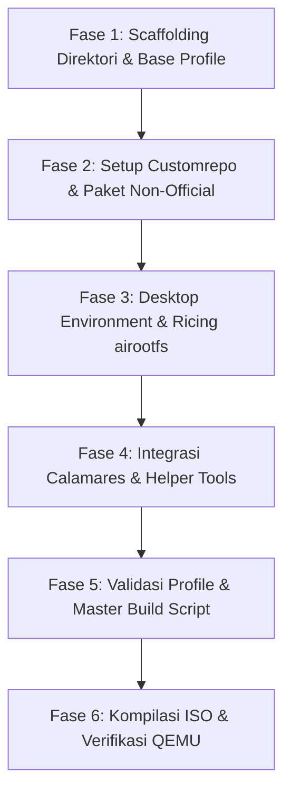

# NusaOS Implementation & Execution Plan

Rencana implementasi bertahap untuk membangun NusaOS dari awal hingga rilis ISO perdana yang dapat di-boot dan diuji di QEMU. Setiap fase memiliki **kriteria penyelesaian (completion criteria)** yang terukur dan dapat diverifikasi secara objektif.

---

## Ringkasan Alur Fase



---

## Fase 1: Scaffolding Direktori & Base Profile

Mempersiapkan struktur pohon kerja di `/home/bimadev/project/antigravity/nusaos` dan menyalin konfigurasi resmi archiso `releng`.

### Langkah-Langkah:
1. Buat direktori kerja: `profile/`, `customrepo/PKGBUILDs/`, `customrepo/x86_64/`, `scripts/`, `out/`.
2. Salin basis `/usr/share/archiso/configs/releng/*` ke dalam `profile/`.
3. Modifikasi `profile/profiledef.sh`:
   - `iso_name="nusaos"`
   - `iso_label="NUSAOS_$(date +%Y%m)"`
   - `iso_publisher="NusaOS Project <https://github.com/nusaos>"`
   - `iso_application="NusaOS Live/Installation Medium"`
   - `install_dir="nusaos"`
   - `bootmodes=('bios.syslinux' 'uefi.systemd-boot')`
   - Pastikan parameter kernel `cow_spacesize=4G` ditambahkan ke bootloader.
4. Perbarui `profile/packages.x86_64` dengan paket dasar:
   - Ganti `linux` dengan `linux-zen`.
   - Tambahkan driver video `mesa`, `vulkan-intel`, `vulkan-radeon`, `vulkan-nouveau`, `xf86-video-amdgpu`, `spice-vdagent`, `qemu-guest-agent`.

### Kriteria Penyelesaian (Gate 1):
- [ ] Folder `profile/` terisi salinan lengkap dari `releng`.
- [ ] Berkas `profiledef.sh` menggunakan `install_dir="nusaos"` dan `bootmodes=('bios.syslinux' 'uefi.systemd-boot')`.
- [ ] Tidak ada referensi `uefi.grub` di `profiledef.sh`.

---

## Fase 2: Setup Custom Repository (`customrepo`)

Mempersiapkan infrastruktur paket lokal untuk menampung paket non-resmi: `brave-bin`, `paru`, `calamares`, `nusa-artwork`, dan `nusa-configs`.

### Langkah-Langkah:
1. Buat skrip pembantu `scripts/setup_customrepo.sh` untuk mengotomasi kompilasi paket AUR yang dibutuhkan ke dalam format `.pkg.tar.zst`.
2. Daftarkan `[customrepo]` di dalam `profile/pacman.conf` tepat sebelum blok `[core]`:
   ```ini
   [customrepo]
   SigLevel = Optional TrustAll
   Server = file:///home/bimadev/project/antigravity/nusaos/customrepo/x86_64
   ```
3. Pastikan tanda komentar `#DownloadUser = alpm` tetap dipertahankan.
4. Susun resep `PKGBUILD` dasar untuk meta-package NusaOS (`nusa-configs` dan `nusa-artwork`).

### Kriteria Penyelesaian (Gate 2):
- [ ] Direktori `customrepo/x86_64` terinisialisasi dengan basis data paket `customrepo.db.tar.gz`.
- [ ] `profile/pacman.conf` berhasil memuat repositori `[customrepo]`.
- [ ] Skrip `setup_customrepo.sh` dapat dijalankan dan menghasilkan paket biner valid.

---

## Fase 3: Desktop Environment & Ricing airootfs

Membangun lingkungan grafis Wayland modern bertema "Zamrud Khatulistiwa" pada `profile/airootfs/`.

### Langkah-Langkah:
1. Daftarkan paket UI di `profile/packages.x86_64`:
   - Compositor & Tooling: `hyprland`, `waybar`, `rofi-wayland`, `dunst`, `polkit-gnome`, `xdg-desktop-portal-hyprland`, `xdg-desktop-portal-gtk`, `hyprlock`, `hypridle`.
   - Aplikasi & File Manager: `kitty`, `thunar`, `thunar-archive-plugin`, `tumbler`, `file-roller`.
   - Audio & Multimedia: `pipewire`, `pipewire-pulse`, `pipewire-alsa`, `wireplumber`, `pavucontrol`, `bluez`, `bluez-utils`, `blueman`.
   - Font & Tema: `inter-font`, `ttf-jetbrains-mono-nerd`, `noto-fonts-emoji`, `papirus-icon-theme`.
   - Shell: `zsh`, `starship`, `zsh-autosuggestions`, `zsh-syntax-highlighting`.
2. Konfigurasi `profile/airootfs/etc/skel/.config/`:
   - `hypr/hyprland.conf`: Pengaturan window rules, keybindings ramah pengguna (Super+Enter terminal, Super+Space launcher, Super+Q close, Super+E file manager, Super+V toggle floating), animasi fluida, dan palet warna Zamrud Khatulistiwa.
   - `waybar/`: Konfigurasi bar atas minimalis dengan modul workspace, window title, network, audio, baterai, dan jam.
   - `rofi/`: Konfigurasi menu aplikasi bergaya modern dengan input box di tengah dan efek transparansi.
   - `kitty/kitty.conf`: Font JetBrains Mono Nerd, ukuran 11, transparansi 0.85, skema warna gelap.
   - `starship.toml`: Skema prompt ringkas dengan aksen hijau zamrud.
3. Konfigurasi Autologin Sesi Live:
   - Buat user `nusa` via `airootfs/etc/passwd`, `shadow`, `group`, `gshadow`.
   - Berikan hak akses penuh via `airootfs/etc/sudoers.d/00_liveuser`.
   - Daftarkan hak berkas pada `file_permissions` di `profiledef.sh`.
   - Konfigurasi autologin systemd getty atau SDDM autologin pada sesi live.

### Kriteria Penyelesaian (Gate 3):
- [ ] Berkas konfigurasi Hyprland, Waybar, Rofi, dan Kitty terpasang di `profile/airootfs/etc/skel/.config/`.
- [ ] Pengguna `nusa` terdaftar di `/etc/passwd` dengan izin sudoer `0:0:0440`.
- [ ] Layanan PipeWire dan NetworkManager memiliki symlink aktif di `airootfs/etc/systemd/system/`.

---

## Fase 4: Integrasi Calamares & Helper Tools

Menyiapkan installer grafis Calamares dan utilitas sistem khas NusaOS.

### Langkah-Langkah:
1. Buat utilitas CLI pembantu di `profile/airootfs/usr/local/bin/`:
   - `nusa-welcome`: Dialog grafis/TUI penyambutan saat desktop pertama kali terbuka, berisi tombol "Install NusaOS" (meluncurkan Calamares), "Pilih Mirror Tercepat", dan tautan dokumentasi.
   - `nusa-mirror`: Skrip otomatisasi untuk memprioritaskan dan menguji kecepatan mirror Indonesia via `reflector`.
2. Siapkan konfigurasi Calamares di `profile/airootfs/etc/calamares/`:
   - `settings.conf`: Urutan modul instalasi (welcome, locale, keyboard, partition, users, packages, summary, install, finished).
   - `modules/welcome.conf`: Teks sambutan dan logo NusaOS.
   - `branding/nusaos/branding.desc`: Definisi visual, wallpaper, dan logo installer.
3. Daftarkan ikon peluncur desktop "Install NusaOS" di `airootfs/etc/skel/Desktop/calamares.desktop`.

### Kriteria Penyelesaian (Gate 4):
- [ ] Calamares terpasang dan memiliki launcher desktop yang dapat dieksekusi.
- [ ] Skrip `nusa-welcome` dan `nusa-mirror` terpasang dengan izin `0:0:0755` di `profiledef.sh`.
- [ ] Modul Calamares terkonfigurasi dengan branding NusaOS.

---

## Fase 5: Validasi Profile & Master Build Script

Mempersiapkan skrip orkestrator terpadu `build.sh` dan skrip validasi integritas profil.

### Langkah-Langkah:
1. Buat skrip validasi `scripts/validate_profile.sh` yang memeriksa:
   - Keberadaan seluruh berkas wajib di `profile/`.
   - Validitas sintaks `profiledef.sh` (tidak ada bootmode usang, `install_dir` valid).
   - Kecocokan referensi kernel antara `packages.x86_64` dan konfigurasi bootloader (`vmlinuz-linux-zen`).
   - Keberadaan izin `file_permissions` untuk `/etc/shadow` dan `/etc/sudoers.d/*`.
2. Buat skrip master `build.sh`:
   - Opsi `-c` (clean work directory dengan aman).
   - Opsi `-p` (jalankan pre-flight profile validation).
   - Opsi `-r` (rebuild customrepo packages).
   - Eksekusi `mkarchiso` dalam mode rootless `unshare` dengan output ke direktori `out/`.
3. Berikan izin eksekusi (`chmod +x build.sh scripts/*.sh`).

### Kriteria Penyelesaian (Gate 5):
- [ ] Skrip `validate_profile.sh` berhasil lulus verifikasi tanpa peringatan/error.
- [ ] Skrip `build.sh` siap dieksekusi dengan *flag argument handling* yang jelas.

---

## Fase 6: Kompilasi ISO & Verifikasi QEMU

Mengeksekusi pembuatan ISO dan memverifikasi fungsionalitasnya di emulator QEMU.

### Langkah-Langkah:
1. Jalankan `build.sh` untuk mengompilasi image ISO NusaOS.
2. Verifikasi berkas keluaran di `out/nusaos-*.iso`.
3. Jalankan pengujian boot UEFI melalui `run_archiso`:
   ```bash
   run_archiso -u -i out/nusaos-*.iso
   ```
4. Verifikasi di dalam mesin virtual:
   - Sistem melakukan autologin ke sesi Hyprland.
   - Waybar tampil dengan tema Zamrud Khatulistiwa.
   - Perintah `kitty`, `brave`, dan `thunar` dapat dibuka via keybind atau Rofi.
   - Audio PipeWire aktif dan mendeteksi dummy device.
   - Calamares dapat diluncurkan tanpa crash.
   - Konsumsi RAM awal di bawah 600 MB.

### Kriteria Penyelesaian (Gate 6):
- [ ] Berkas ISO NusaOS terhasilkan tanpa galat.
- [ ] Live environment berhasil boot di UEFI QEMU ke sesi Hyprland.
- [ ] Konsumsi RAM idle terukur < 600 MB.
- [ ] Calamares berhasil menyelesaikan simulasi instalasi.
